# Relay — Phase-wise Implementation Plan

Design reference: [ARCHITECTURE.md](ARCHITECTURE.md) (section numbers `§` below point there).
Each phase ends in a **runnable, committable** state. Time boxes assume AI-assisted coding: Phases 0–7 (Must Have) ≈ 4 h, Phases 8–9 (docs + demo) ≈ 45 min.

---

## Timeline Overview

| Phase | Scope | Time box | Exit gate |
|---|---|---|---|
| 0 | Foundation: project, Atlas, pack files | 20 min | Atlas connected, indexes created, mock world up |
| 1 | Core domain: catalog, validator, templates | 35 min | unit tests green |
| 2 | Persistence + Workflow API + seeding | 35 min | 4 seeds published via API |
| 3 | Triggers + worker + deterministic nodes | 50 min | `pay_102` succeeds, runaway capped |
| 4 | Approvals, gate, cancel | 30 min | **smoke test passes** |
| 5 | Durability drill | 20 min | **duplication check PASS** |
| 6 | AI node + engine tests | 35 min | injections parked, schema enforced |
| 7 | Console | 25 min | approve/reject from browser |
| 8 | README + verification report | 25 min | docs complete |
| 9 | Demo video | 20 min | video recorded |

```mermaid
gantt
    dateFormat  HH:mm
    axisFormat  %H:%M
    section Must Have
    P0 Foundation        :p0, 00:00, 20m
    P1 Core domain       :p1, after p0, 35m
    P2 Persistence + API :p2, after p1, 35m
    P3 Worker + nodes    :p3, after p2, 50m
    P4 Approvals/cancel  :p4, after p3, 30m
    P5 Durability drill  :p5, after p4, 20m
    P6 AI node + tests   :p6, after p5, 35m
    P7 Console           :p7, after p6, 25m
    section Deliverables
    P8 Docs              :p8, after p7, 25m
    P9 Video             :p9, after p8, 20m
```



---

## Phase 0 — Foundation (20 min)

**Tasks**
- [x] `npm init`; package is **ESM** (`"type": "module"`, NestJS 12 is ESM-only); TypeScript `strict`, `module: NodeNext`, decorators + metadata; build with `tsc`; tests with **Vitest**.
- [x] Dependencies: `@nestjs/core @nestjs/common @nestjs/platform-express (v12) reflect-metadata rxjs mongodb ajv ulid dotenv`.
- [x] Dev dependencies: `typescript @types/node vitest`. `npm audit` → 0 vulnerabilities.
- [ ] **MongoDB Atlas** *(you)*: create a free M0 cluster → Database Access: create a DB user → Network Access: add your current IP → copy the SRV connection string into `.env` as `MONGODB_URI` (never commit it).
- [ ] **Groq** *(you)*: put the API key in `.env` as `AI_API_KEY` (never commit or paste it anywhere else).
- [x] **Python 3.9+**: 3.13.17 installed; `validate_pack.py` OK; mock world `/health` OK.
- [x] `.env.example` with all variables from §15 (placeholders only, no secrets); `src/config.ts` parses them.
- [x] Copy from the pack: `data/node_catalog.json`, `data/seed_workflows.json`, `data/sample_payloads.jsonl`, `data/nl_eval.jsonl`, `scripts/mock_world.py`, `scripts/smoke_test.py`, `scripts/duplication_check.py`, `scripts/mock_provider.py`, `scripts/validate_pack.py`.
- [x] `src/infra/db/mongo.ts` (single `MongoClient`, `serverSelectionTimeoutMS`, `withTransaction` helper with snapshot read / majority write concern, `isDuplicateKeyError`) + `src/infra/db/indexes.ts` (collections + all indexes from §6) + `src/cli/db-indexes.ts`.
- [x] npm scripts: `build`, `typecheck`, `api`, `worker`, `db:indexes`, `seed`, `test`, `test:watch`.
- [x] `.gitignore`: `node_modules`, `dist`, `coverage`, `.env`, `.worker.pid`, `*.log`.

**Exit criteria**
- `npm run db:indexes` → 5 collections with their indexes visible in Atlas (Collections → Indexes tab).
- `python scripts/mock_world.py --port 9210` → `GET /health` OK.

**Fallback:** Atlas blocked by the network (port 27017 outbound) → local MongoDB started as a single-node replica set (`mongod --replSet rs0` + `rs.initiate()`), required for transactions.

---

## Phase 1 — Core Domain: Catalog, Validator, Templates (35 min)

**Tasks**
- [x] `core/domain/types.ts` (§5), `core/domain/errors.ts` (`DomainError`, `StepError` → `TransientError` / `PermanentError`).
- [x] `core/catalog/catalog.ts`: index by type; `node()`, `trigger()`, `isSideEffect()`, `requiresApproval()`, `isBranching()`. Loading from disk lives in `infra/data/pack-data.ts`.
- [x] `core/catalog/validator.ts`: every rule in §7.1 + `invalid_key`; collects all errors; returns `{ok, errors[], warnings[]}`.
- [x] `core/validation/json-schema.ts` (Ajv compile cache + error formatting) and `core/guardrails/safe-keys.ts`.
- [x] `core/templates/resolver.ts`:
  - roots `trigger.body.*` and `nodes.<id>.output.*`; segments `[A-Za-z0-9_-]`; own properties only.
  - whole-string template → keep raw type; embedded → stringify (objects via `JSON.stringify`).
  - deep-resolve objects/arrays (for `http_request.body`, `headers`).
  - **single pass** — never re-scan substituted values.
  - missing path → `PermanentError('template_unresolved', 'Cannot resolve {{x}}')`.
- [x] Tests: `test/unit/validator.spec.ts`, `test/unit/resolver.spec.ts` (§17.1) → 32/32 green.

**Exit criteria**
- `npm test` green; all 4 seeds validate; 3 smoke-test bad cases rejected with distinct codes; loop in `wf_runaway` accepted.

---

## Phase 2 — Persistence + Workflow API + Seeding (35 min)

**Tasks**
- [ ] `core/ports/*.ts` interfaces (§12).
- [ ] `infra/repositories/mongo-repository.ts`: workflows (create/get/list/updateDraft/publish), runs, steps, approvals, `hasApprovedApproval`; map duplicate-key `11000` to domain errors (e.g. `workflow_exists`).
- [ ] `infra/queue/mongo-queue.ts`: `enqueue` (upsert, `_id = run_id`), `claim` (atomic `findOneAndUpdate` + lease §8.3), `release`, `remove`.
- [ ] `core/services/workflow.service.ts`: create (shape check, 409 exists), update draft, publish (validate → copy to `published_definition`, `version++`).
- [ ] `infra/seed/seed.ts` (§13), invoked on API boot and via `npm run seed`.
- [ ] NestJS: `app.module.ts`, `main.ts` (body limit 256 kB), `auth.guard.ts` (Bearer, skip `/hooks`, `/health`, `/console`), `http-error.filter.ts` (§10.3 shape).
- [ ] Input guard: reject trigger bodies / definitions with keys starting with `$` or containing `.` (NoSQL operator injection, §14).
- [ ] `core/guardrails/redact.ts`; apply to all workflow responses.
- [ ] `WorkflowsController`: `GET /workflows`, `GET /workflows/:id`, `POST /workflows`, `PUT /workflows/:id`, `POST /workflows/:id/publish`, `GET /catalog`, `GET /health`.

**Exit criteria**
- `GET /workflows` lists 4 seeds with `status: "published"`.
- Bad definitions → 422 with `code` per rule; duplicate id → 409.
- Webhook secrets not visible in any response.

---

## Phase 3 — Triggers + Worker + Deterministic Nodes (50 min)

**Tasks**
- [ ] `core/services/trigger.service.ts`: one transaction → insert run (`queued`, snapshot, version, input) + insert job.
- [ ] `POST /workflows/:id/trigger` (`{"input":{}}` → 202 `{run_id}`), 409 if never published, 400 if input not an object.
- [ ] `HooksController` `POST /hooks/:id`: constant-time secret compare (§10.2), 401 wrong/missing, 409 if trigger type ≠ webhook.
- [ ] `RunsController`: `GET /runs`, `GET /runs/:id` (trace shape §10.4).
- [ ] `core/engine/transitions.ts` (allowed transitions map + guarded update).
- [ ] `core/engine/retry.ts` (classification + backoff §15).
- [ ] `core/engine/engine.ts` → `advance()` exactly as §8.4 (NEW vs RE-EXECUTE, step cap, gate, persist → act → persist).
- [ ] `infra/world/http-world-client.ts` (fetch, `AbortSignal.timeout(HTTP_TIMEOUT_MS)`, `Idempotency-Key`, parse JSON, map errors).
- [ ] Handlers: `condition` (§11.2), `notify` (§11.4), `http_request` + URL allowlist (§11.1), `delay` durable re-queue (§11.3).
- [ ] `src/worker/main.ts`: loop (§8.3), `WORKER_ID`, write `.worker.pid`, graceful SIGINT/SIGTERM.

**Exit criteria**
- `pay_102` (`$40`) via webhook → `succeeded`; trace shows `is_large` → `auto_ok`.
- Ledger (`GET :9210/admin/ledger`) shows `email.send` with an `idempotency_key`.
- `wf_runaway` → `failed`, `error.code = max_steps_exceeded`, `steps_executed = 12`.
- `{"mode":"down"}` on world → step retries visible in `attempts_log`; restore → run completes.

---

## Phase 4 — Approvals, Gate, Cancel (30 min)

**Tasks**
- [ ] `approval` handler (§11.6): insert approval (duplicate key = already exists), step `waiting`, run `waiting_approval`, remove job.
- [ ] `core/services/approval.service.ts` + `ApprovalsController`: `GET /approvals?status=pending`, `POST /approvals/:id/approve`, `POST /approvals/:id/reject` (transactions §10.2, 409 on re-decide, `decided_by="demo-user"`, `decided_at`).
- [ ] `core/guardrails/approval-gate.ts` used by engine before any `requires_approval` node; `order_action` handler (§11.7) re-checks.
- [ ] `order_action` handler: refund / replacement, `order_id` regex + encoding, permanent 4xx.
- [ ] `core/services/run.service.ts` + `POST /runs/:id/cancel` (4 cases §10.2); engine checks `cancel_requested` between steps.

**Exit criteria**
- `python scripts/smoke_test.py --url http://localhost:8080 --token relay-demo-token` → **all PASS** (explain any WARN).
- Reject → run `cancelled`, `ended_by = rejected`.
- Second approve on same approval → 409.
- Cancel on terminal run → 409.

---

## Phase 5 — Durability Drill (20 min)

**Procedure (PowerShell)**
```powershell
Invoke-RestMethod -Method Post http://localhost:9210/admin/reset
Invoke-RestMethod -Method Post http://localhost:8080/workflows/wf_slow_fulfillment/trigger `
  -Headers @{Authorization="Bearer relay-demo-token"} -ContentType 'application/json' `
  -Body '{"input":{"order_id":"ord_2003","customer_email":"lena@example.com"}}'
# wait until the confirm email appears in the ledger, then during the 20s delay:
Stop-Process -Id (Get-Content .worker.pid) -Force
npm run worker          # restart; run resumes after lease expiry (≤ 30 s)
python scripts/duplication_check.py --url http://localhost:9210
```

**Tasks**
- [ ] Run the drill; record the kill point and the output.
- [ ] Fix any bug found (typical: re-execution allocating a new sequence → key changes; delay restarting from zero; lease never expiring).
- [ ] Optional second kill point: between `create_shipment` call and persist (add `CRASH_AFTER_CALL=create_shipment` env hook that `process.exit(1)` after the world call).

**Exit criteria**
- `duplication_check.py` → `PASS`, exit code 0, no keyless WARN; `email.send` ×2 (confirm + shipped), `shipment.create` ×1.

---

## Phase 6 — AI Node + Engine Tests (35 min)

**Tasks**
- [ ] `core/ports/ai-provider.ts`.
- [ ] `infra/ai/openai-compatible.provider.ts` targeting **Groq** (`POST {AI_BASE_URL}/chat/completions`, `model: openai/gpt-oss-120b`, `response_format: {type:"json_object"}`, `temperature: 0`, `AbortSignal.timeout(AI_TIMEOUT_MS)`, map 429/5xx → Transient (honour `Retry-After`), 401/400 → Permanent, `usage.prompt_tokens/completion_tokens` → tokens).
- [ ] `infra/ai/heuristic.provider.ts` (keywords: refund/money back → `refund_request`; broken/cracked/disappointed → `complaint`; else `question`; priority by urgency words; summary = first 200 chars, sanitized).
- [ ] `infra/ai/fake.provider.ts` (scripted replies queue for tests).
- [ ] `ai` handler (§11.5): system guard prompt, parse, Ajv, one repair, `ai_attempts`, tokens → step + run.
- [ ] `test/fakes/in-memory-repository.ts`, `test/fakes/fake-world.ts`.
- [ ] `test/unit/ai-schema.spec.ts`, `test/unit/retry.spec.ts`, `test/engine/engine.spec.ts` (all cases §17.2).

**Exit criteria**
- `pay_001` → `complaint` → `#support` chat; trace shows tokens.
- `pay_002` → `waiting_approval` → approve → `order.refund` once → customer email.
- `pay_inject_001` → `waiting_approval`; ledger has no `order.refund` before approval.
- `pay_inject_002` → only `chat.message` to `#support`; no email to attacker.
- Schema failure demo: two `ai_attempts` in trace (repair), then success or `ai_output_invalid`.
- `npm test` green.

---

## Phase 7 — Console (25 min)

**Tasks**
- [ ] `src/api/console/index.html` served at `/console` (static, no auth on the page itself; API calls use the token field).
- [ ] Tabs per §16: Workflows (+ trigger with JSON box), Runs (+ trace view, Cancel), Approvals (+ Approve / Reject).
- [ ] Auto-refresh 2 s; status colour badges; render with `textContent` only.

**Exit criteria**
- From the browser: trigger `pay_101`, see `waiting_approval`, approve, see `succeeded` with full trace.

---

## Phase 8 — Documentation (25 min)

**README.md**
- [ ] Overview + architecture diagram (from §3).
- [ ] Prerequisites (Node 20+, MongoDB Atlas account, Groq API key, Python 3.9+), env vars table (§15).
- [ ] Setup: `npm i` → copy `.env.example` to `.env` and fill `MONGODB_URI` + `AI_API_KEY` → `npm run db:indexes` → `python scripts/mock_world.py --port 9210` → `npm run api` → `npm run worker` → open `/console`.
- [ ] API reference (§10.1) + curl/PowerShell examples for each sample payload.
- [ ] Run state machine diagram (§8.1) + step state machine.
- [ ] Exactly-once design: key scheme + crash-window table (§9).
- [ ] Guardrails table (§14).
- [ ] Testing: `npm test`, smoke test, drill.
- [ ] Demo reproduction steps (Phase 9 script).
- [ ] Design decisions (MongoDB Atlas as store + queue instead of Postgres and the equivalence table, snapshot field, separate worker, Groq + heuristic fallback) + known limitations (§18).

**docs/VERIFICATION_REPORT.md**
- [ ] Smoke test output (all PASS; WARNs explained).
- [ ] Duplication check output + where the worker was killed.
- [ ] Injection payload traces (`pay_inject_001`, `pay_inject_002`) and what they showed.
- [ ] Idempotency key scheme + crash-window answer.
- [ ] `npm test` summary.
- [ ] Known limitations.

---

## Phase 9 — Demo Video (20 min)

| # | Scene | Shows |
|---|---|---|
| 1 | Architecture diagram (30 s) | API / worker / MongoDB Atlas / mock world |
| 2 | `pay_001` via webhook | trigger, AI node branching, trace with tokens |
| 3 | `pay_inject_001` | parked at approval → reject → ledger has no refund |
| 4 | `pay_101` in console | approval gate → approve → succeeded |
| 5 | Kill-and-resume | `Stop-Process -Force` during delay → restart → `duplication_check.py` PASS |
| 6 | `wf_runaway` | failed at step 12 with `max_steps` reason |
| 7 | World `down` mid-run | retries/backoff in trace → restore → completes |
| 8 | Schema enforcement | AI attempt invalid → repair visible in trace |

Upload, make the GitHub repo public, submit both links.

---

## Stretch (only after everything above)
- NL compiler `POST /workflows/compile` + eval command over `data/nl_eval.jsonl` (reuse validator, refuse missing capabilities, force approval before `order_action`).
- Enforce `limits.timeout_seconds` and `limits.max_ai_tokens`.
- Cron schedule triggers (1-minute granularity).
- Role separation (builder / operator / approver tokens).
- Integration tests for `MongoQueue` lease/reclaim using `mongodb-memory-server` (replica-set mode).
- Lease heartbeat for long AI calls; change streams to cut poll latency.

---

## Risks & Mitigations

| Risk | Mitigation |
|---|---|
| Atlas unreachable (IP not allowlisted / network blocks 27017) | Add current IP in Atlas Network Access; fallback local `mongod --replSet rs0` |
| Transactions need a replica set | Atlas is one; local fallback must be started with `--replSet` |
| Groq rate limits (free tier) | 429 retried with backoff; switch `AI_PROVIDER=heuristic` for the demo if needed |
| Secrets leaked (Atlas URI, Groq key) | Only in `.env` (git-ignored); `.env.example` holds placeholders; `redact()` on logs/errors |
| Re-execution uses a new sequence → duplicate side effect | Engine decides RE-EXECUTE vs NEW strictly from last step status; covered by engine test |
| Status outside vocabulary during delay/retry | Run stays `running`; only job timing changes |
| Kill drill timing | 30 s lease (reclaim ≤ 30 s after kill), 20 s delay, PID file for instant kill |
| Smoke test 30 s poll timeout after approval | `POLL_MS=500`; approve enqueues with `available_at=now()` |
| Windows has no `python3` / `py` | install Python 3.12, use `python` |
| Running out of time | Protect order: smoke test → duplication check → gate/injection → AI schema → console → docs polish |

---

## Definition of Done
- [ ] Smoke test: all PASS (WARNs explained).
- [ ] Duplication check: PASS after a live kill -9.
- [ ] `npm test`: validator, resolver, schema, idempotency, gate bypass, injection, step cap — green.
- [ ] Console shows workflows, runs, trace, approvals with buttons.
- [ ] README + verification report + demo video + public GitHub link submitted.
