# Relay — Phase-wise Implementation Plan

Design reference: [ARCHITECTURE.md](ARCHITECTURE.md) (section numbers `§` below point there).
Each phase ends in a **runnable, committable** state. Time boxes assume AI-assisted coding: Phases 0–7 (Must Have) ≈ 4 h, Phases 8–9 (docs + demo) ≈ 45 min.

---

## Timeline Overview

| Phase | Scope | Time box | Exit gate |
|---|---|---|---|
| 0 | Foundation: project, Atlas, pack files | 20 min | Atlas connected, indexes created, mock world up |
| 1 | Core domain: catalog, validator, templates | 35 min | unit tests green |
| 2 | Persistence + Workflow API + seeding | 35 min | 4 seeds published via API |
| 3 | Triggers + worker + deterministic nodes | 50 min | `pay_102` succeeds, runaway capped |
| 4 | Approvals, gate, cancel | 30 min | **smoke test passes** |
| 5 | Durability drill | 20 min | **duplication check PASS** |
| 6 | AI node + engine tests | 35 min | injections parked, schema enforced |
| 7 | Console | 25 min | approve/reject from browser |
| 8 | README + verification report | 25 min | docs complete |
| 9 | Demo video | 20 min | video recorded |

```mermaid
gantt
    dateFormat  HH:mm
    axisFormat  %H:%M
    section Must Have
    P0 Foundation        :p0, 00:00, 20m
    P1 Core domain       :p1, after p0, 35m
    P2 Persistence + API :p2, after p1, 35m
    P3 Worker + nodes    :p3, after p2, 50m
    P4 Approvals/cancel  :p4, after p3, 30m
    P5 Durability drill  :p5, after p4, 20m
    P6 AI node + tests   :p6, after p5, 35m
    P7 Console           :p7, after p6, 25m
    section Deliverables
    P8 Docs              :p8, after p7, 25m
    P9 Video             :p9, after p8, 20m
```



---

## Phase 0 — Foundation (20 min)

**Tasks**
- [x] `npm init`; package is **ESM** (`"type": "module"`, NestJS 12 is ESM-only); TypeScript `strict`, `module: NodeNext`, decorators + metadata; build with `tsc`; tests with **Vitest**.
- [x] Dependencies: `@nestjs/core @nestjs/common @nestjs/platform-express (v12) reflect-metadata rxjs mongodb ajv ulid dotenv`.
- [x] Dev dependencies: `typescript @types/node vitest`. `npm audit` → 0 vulnerabilities.
- [ ] **MongoDB Atlas** *(you)*: create a free M0 cluster → Database Access: create a DB user → Network Access: add your current IP → copy the SRV connection string into `.env` as `MONGODB_URI` (never commit it).
- [ ] **Groq** *(you)*: put the API key in `.env` as `AI_API_KEY` (never commit or paste it anywhere else).
- [x] **Python 3.9+**: 3.13.17 installed; `validate_pack.py` OK; mock world `/health` OK.
- [x] `.env.example` with all variables from §15 (placeholders only, no secrets); `src/config.ts` parses them.
- [x] Copy from the pack: `data/node_catalog.json`, `data/seed_workflows.json`, `data/sample_payloads.jsonl`, `data/nl_eval.jsonl`, `scripts/mock_world.py`, `scripts/smoke_test.py`, `scripts/duplication_check.py`, `scripts/mock_provider.py`, `scripts/validate_pack.py`.
- [x] `src/infra/db/mongo.ts` (single `MongoClient`, `serverSelectionTimeoutMS`, `withTransaction` helper with snapshot read / majority write concern, `isDuplicateKeyError`) + `src/infra/db/indexes.ts` (collections + all indexes from §6) + `src/cli/db-indexes.ts`.
- [x] npm scripts: `build`, `typecheck`, `api`, `worker`, `db:indexes`, `seed`, `test`, `test:watch`.
- [x] `.gitignore`: `node_modules`, `dist`, `coverage`, `.env`, `.worker.pid`, `*.log`.

**Exit criteria**
- `npm run db:indexes` → 5 collections with their indexes visible in Atlas (Collections → Indexes tab).
- `python scripts/mock_world.py --port 9210` → `GET /health` OK.

**Fallback:** Atlas blocked by the network (port 27017 outbound) → local MongoDB started as a single-node replica set (`mongod --replSet rs0` + `rs.initiate()`), required for transactions.

---

## Phase 1 — Core Domain: Catalog, Validator, Templates (35 min)

**Tasks**
- [x] `core/domain/types.ts` (§5), `core/domain/errors.ts` (`DomainError`, `StepError` → `TransientError` / `PermanentError`).
- [x] `core/catalog/catalog.ts`: index by type; `node()`, `trigger()`, `isSideEffect()`, `requiresApproval()`, `isBranching()`. Loading from disk lives in `infra/data/pack-data.ts`.
- [x] `core/catalog/validator.ts`: every rule in §7.1 + `invalid_key`; collects all errors; returns `{ok, errors[], warnings[]}`.
- [x] `core/validation/json-schema.ts` (Ajv compile cache + error formatting) and `core/guardrails/safe-keys.ts`.
- [x] `core/templates/resolver.ts`:
  - roots `trigger.body.*` and `nodes.<id>.output.*`; segments `[A-Za-z0-9_-]`; own properties only.
  - whole-string template → keep raw type; embedded → stringify (objects via `JSON.stringify`).
  - deep-resolve objects/arrays (for `http_request.body`, `headers`).
  - **single pass** — never re-scan substituted values.
  - missing path → `PermanentError('template_unresolved', 'Cannot resolve {{x}}')`.
- [x] Tests: `test/unit/validator.spec.ts`, `test/unit/resolver.spec.ts` (§17.1) → 32/32 green.

**Exit criteria**
- `npm test` green; all 4 seeds validate; 3 smoke-test bad cases rejected with distinct codes; loop in `wf_runaway` accepted.

---

## Phase 2 — Persistence + Workflow API + Seeding (35 min)

**Tasks**
- [x] `core/ports/{repository,queue,clock}.ts` (§12). Enqueue/remove job are **Repository** methods so they join transactions; `Queue` only claims/releases.
- [x] `infra/repositories/mongo-repository.ts`: workflows, runs, steps, approvals (idempotent upsert), jobs, `hasApprovedApproval`, `holdsJobLease` (fencing); `transaction()` binds a session.
- [x] `infra/queue/mongo-queue.ts`: `claim` (atomic `findOneAndUpdate` + lease §8.3), `release`.
- [x] `core/services/workflow.service.ts`: create (shape + unsafe-key check, 409 exists, returns validation preview), update draft (optimistic on `updated_at`), publish (validate → copy to `published_definition`, `version++`), seed.
- [x] Seeding on API boot (`api/context.ts`) and via `npm run seed` (`src/cli/seed.ts`).
- [x] NestJS: `app.module.ts` (dynamic module over pre-built core objects), `main.ts` (body limit 256 kB, body-parser errors in contract shape), `auth.ts` (Bearer guard + `@Public()`, constant-time compare), `http-error.filter.ts` + `error-response.ts` (§10.3 shape).
- [x] Input guard: definitions with keys starting with `$` or containing `.` → 400 `invalid_key`.
- [x] `core/guardrails/redact.ts` applied to workflow responses (`secret` → `[redacted]`).
- [x] Controllers: `GET /workflows`, `GET /workflows/:id`, `POST /workflows`, `PUT /workflows/:id`, `POST /workflows/:id/publish`, `GET /catalog`, `GET /health`.
- [x] Tests: `test/fakes/in-memory-repository.ts`, `workflow-service.spec.ts`, `guardrails.spec.ts` → 45/45 green.

**Exit criteria** — met
- `GET /workflows` lists 4 seeds with `status: "published"` (smoke §1 all PASS).
- Bad definitions → 422 with `code` per rule (smoke §3 all PASS); duplicate id → 409.
- Webhook secrets show as `[redacted]`.

---

## Phase 3 — Triggers + Worker + Deterministic Nodes (50 min)

**Tasks**
- [x] `core/services/trigger.service.ts`: one transaction → insert run (`queued`, snapshot, version, input) + upsert job.
- [x] `POST /workflows/:id/trigger` (`{"input":{}}` → 202 `{run_id}`), 409 if never published, 400 if input not an object / unsafe keys.
- [x] `HooksController` `POST /hooks/:id` (`@Public`): constant-time secret compare (`core/guardrails/secrets.ts`), 401 wrong/missing, 409 if trigger type ≠ webhook.
- [x] `RunsController`: `GET /runs`, `GET /runs/:id` (trace shape §10.4, secrets redacted).
- [x] Guarded status transitions: done inside the engine via `updateRun(..., { fromStatuses })` (no separate `transitions.ts`).
- [x] `core/engine/retry.ts` (408/429/5xx retryable, other 4xx permanent; backoff with jitter).
- [x] `core/engine/engine.ts` → `advance()` as §8.4 (NEW vs RE-EXECUTE, step cap, gate, persist → act → persist, lease renew + fencing on every write, poison-job cap).
- [x] `infra/world/http-world-client.ts` (fetch, `AbortSignal.timeout`, no redirects, `Idempotency-Key`).
- [x] Handlers: `condition`, `notify`, `http_request` + URL allowlist, `delay` (resume time anchored to step creation). Also pulled forward: `approval`, `order_action`.
- [x] `src/worker/main.ts`: loop, `WORKER_ID`, `.worker.pid`, graceful SIGINT/SIGTERM, release with backoff on unexpected errors.
- [x] Tests: `test/fakes/{fake-world,harness}.ts`, `test/engine/engine.spec.ts` (20), `test/unit/retry.spec.ts` (15) → 80/80 green.

**Exit criteria** — met
- `$40` via webhook → `succeeded`; trace `is_large` → `auto_ok` (smoke §5 PASS).
- Ledger shows the notify with an `idempotency_key` (smoke §2 PASS, no WARN).
- `wf_runaway` → `failed`, `max_steps_exceeded`, `steps_executed = 12` (smoke §6 PASS; engine test).
- Retries visible in `attempts_log` (engine tests with 503 + timeout); live world-down drill deferred to Phase 5/demo.
- **Live smoke test: 25 PASS / 1 FAIL** — only "pending approval listed" (Phase 4).

---

## Phase 4 — Approvals, Gate, Cancel (30 min)

**Tasks**
- [x] `approval` handler (§11.6) + engine pause: insert approval (idempotent upsert), step `waiting`, run `waiting_approval`, remove job. *(done in Phase 3)*
- [x] `core/services/approval.service.ts` + `ApprovalsController`: `GET /approvals?status=pending`, `GET /approvals/:id`, `POST /approvals/:id/approve`, `POST /approvals/:id/reject` (one transaction each, guarded on `status='pending'` → 409 on re-decide, `decided_by="demo-user"`, `decided_at`, optional `comment`).
- [x] Engine gate before any `requires_approval` node (inline in `engine.ts`); `order_action` handler re-checks. *(done in Phase 3)*
- [x] `order_action` handler: refund / replacement, `order_id` regex + encoding, permanent 4xx. *(done in Phase 3)*
- [x] `RunService.cancel` + `POST /runs/:id/cancel` (queued / waiting_approval → cancelled at once with approval closed; running → `cancel_requested` + `expediteJob` so a sleeping run wakes; terminal → 409); engine checks `cancel_requested` between steps and marks a waiting step `cancelled`.
- [x] Tests: `test/engine/approvals.spec.ts` (10) → 90/90 green.

**Exit criteria** — met
- **Smoke test: 28 PASS, 0 WARN, 0 FAIL** (live, API :8091 + worker + mock world + Atlas).
- Reject → run `cancelled`, `ended_by = rejected` (live + test).
- Second approve on same approval → 409 (live + test).
- Cancel on terminal run → 409 (live + test).

---

## Phase 5 — Durability Drill (20 min)

**Procedure (PowerShell)**
```powershell
Invoke-RestMethod -Method Post http://localhost:9210/admin/reset
Invoke-RestMethod -Method Post http://localhost:8090/workflows/wf_slow_fulfillment/trigger `
  -Headers @{Authorization="Bearer relay-demo-token"} -ContentType 'application/json' `
  -Body '{"input":{"order_id":"ord_2003","customer_email":"lena@example.com"}}'
# wait until the confirm email appears in the ledger, then during the 20s delay:
Stop-Process -Id (Get-Content .worker.pid) -Force
npm run worker          # restart; run resumes after lease expiry (≤ 30 s)
python scripts/duplication_check.py --url http://localhost:9210
```

**Tasks**
- [x] Run the drill; record the kill point and the output → [VERIFICATION_REPORT.md](VERIFICATION_REPORT.md) §2 (Drill A: killed during `pack_delay`).
- [x] Fix any bug found — none found; both drills passed first time.
- [x] Second kill point between the `create_shipment` call and its persist: `RELAY_CRASH_AFTER_CALL=create_shipment` (drill-only, `src/infra/world/crash-after-call.ts`) → Drill B: 1 shipment executed, 1 replay absorbed.

**Exit criteria** — met
- `duplication_check.py` → `PASS`, exit code 0, no keyless WARN; `email.send` ×2, `shipment.create` ×1 — in **both** drills.

---

## Phase 6 — AI Node + Engine Tests (35 min)

**Tasks**
- [x] `core/ports/ai-provider.ts` (done in Phase 3).
- [x] `infra/ai/openai-compatible.provider.ts` targeting **Groq** (`model: openai/gpt-oss-120b`, JSON mode, `temperature: 0`, `reasoning_effort: low`, `AbortSignal.timeout(AI_TIMEOUT_MS)`, 408/429/5xx → Transient, other 4xx → Permanent, Groq `json_validate_failed` 400 → handed back as text so it goes through the repair path, usage → tokens).
- [x] `infra/ai/heuristic.provider.ts` (offline fallback; fills whatever the schema asks for from keyword rules; never echoes customer text) + `infra/ai/create-provider.ts`.
- [x] Scripted fake model for tests: `test/fakes/fake-ai.ts` (runtime `AI_PROVIDER` is now `openai | heuristic`).
- [x] `core/nodes/ai.ts` (§11.5): guard system prompt + schema, parse (code fences tolerated), Ajv, one repair with the errors appended, `ai_attempts`, tokens → step + run; permanent `ai_output_invalid` keeps attempts + tokens in the trace (`StepError.trace`).
- [x] Fakes `in-memory-repository.ts`, `fake-world.ts` (done in Phases 2–3).
- [x] Tests: `test/unit/ai-node.spec.ts` (13), `test/engine/ai-triage.spec.ts` (8) → 110/110 green.

**Exit criteria** — met live with real Groq (see [VERIFICATION_REPORT.md](VERIFICATION_REPORT.md) §5)
- `pay_001` → `complaint` → `#support` chat; trace shows tokens (393).
- `pay_002` → `waiting_approval` → approve → `order.refund` once → customer email.
- `pay_inject_001` → `waiting_approval`; no `order.refund` before a human decision; rejected → `cancelled`.
- `pay_inject_002` → only `chat.message` to `#support`; no email to the attacker.
- Schema failure demo: two `ai_attempts` with Ajv errors in the trace, then `ai_output_invalid`.
- `npm test` green.

---

## Phase 7 — Console (25 min)

**Tasks**
- [x] `src/api/console/index.html` served at `/console` (public page; read from disk per request; strict CSP, `nosniff`, `no-store`, no framing); `/` redirects to `/console`; API calls use the token field (stored in `localStorage`).
- [x] Tabs: Workflows (trigger form prefilled from `GET /samples`, manual or webhook with secret), Runs (status filter, trace view with expandable steps: resolved input, output, idempotency key, attempts, AI attempts, tokens; inline Approve/Reject; Cancel), Approvals (pending cards with comment + Approve/Reject, recently decided table), pending count badge.
- [x] Auto-refresh 2 s (skips the Workflows form; approvals only re-render when the set changes so typed comments survive; open trace steps stay open); status colour badges; every value rendered via text nodes (no `innerHTML`).

**Exit criteria** — met (checked in the browser)
- Triggered `pay_101` from the Workflows tab → `waiting_approval` → approved from the Approvals tab with a comment → run `succeeded`, `ended_by: completed`, full 3-step trace visible.

---

## Phase 8 — Documentation (25 min)

**README.md**
- [x] Overview + architecture diagram (from §3).
- [x] Prerequisites (Node 20+, MongoDB Atlas account, Groq API key, Python 3.9+), env vars table (§15).
- [x] Setup: `npm i` → copy `.env.example` to `.env` and fill `MONGODB_URI` + `AI_API_KEY` → `npm run db:indexes` → `python scripts/mock_world.py --port 9210` → `npm run api` → `npm run worker` → open `/console`.
- [x] API reference (§10.1) + curl/PowerShell examples for each sample payload.
- [x] Run state machine diagram (§8.1) + step state machine.
- [x] Exactly-once design: key scheme + crash-window table (§9).
- [x] Guardrails table (§14).
- [x] Testing: `npm test`, smoke test, drill.
- [x] Demo reproduction steps (Phase 9 script → `docs/DEMO_SCRIPT.md`).
- [x] Design decisions (MongoDB Atlas as store + queue instead of Postgres and the equivalence table, snapshot field, separate worker, Groq + heuristic fallback) + known limitations (§18).

**docs/VERIFICATION_REPORT.md**
- [x] Smoke test output (all PASS; WARNs explained).
- [x] Duplication check output + where the worker was killed.
- [x] Injection payload traces (`pay_inject_001`, `pay_inject_002`) and what they showed.
- [x] Idempotency key scheme + crash-window answer.
- [x] `npm test` summary.
- [x] Known limitations (+ outage / flaky-world drills).

**Status:** done — `npm run db:reset-demo` added for a clean demo database.

---

## Phase 9 — Demo Video (20 min)

| # | Scene | Shows |
|---|---|---|
| 1 | Architecture diagram (30 s) | API / worker / MongoDB Atlas / mock world |
| 2 | `pay_001` via webhook | trigger, AI node branching, trace with tokens |
| 3 | `pay_inject_001` | parked at approval → reject → ledger has no refund |
| 4 | `pay_101` in console | approval gate → approve → succeeded |
| 5 | Kill-and-resume | `Stop-Process -Force` during delay → restart → `duplication_check.py` PASS |
| 6 | `wf_runaway` | failed at step 12 with `max_steps` reason |
| 7 | World `down` mid-run | retries/backoff in trace → restore → completes |
| 8 | Schema enforcement | AI attempt invalid → repair visible in trace |

Upload, make the GitHub repo public, submit both links.

**Status:** script written — [DEMO_SCRIPT.md](DEMO_SCRIPT.md) (prep, 10 scenes, troubleshooting; `docs/demo/wf_schema_demo.json` for scene 9). Recording is up to you.

---

## Stretch (only after everything above)
- NL compiler `POST /workflows/compile` + eval command over `data/nl_eval.jsonl` (reuse validator, refuse missing capabilities, force approval before `order_action`).
- Enforce `limits.timeout_seconds` and `limits.max_ai_tokens`.
- Cron schedule triggers (1-minute granularity).
- Role separation (builder / operator / approver tokens).
- Integration tests for `MongoQueue` lease/reclaim using `mongodb-memory-server` (replica-set mode).
- Lease heartbeat for long AI calls; change streams to cut poll latency.

---

## Risks & Mitigations

| Risk | Mitigation |
|---|---|
| Atlas unreachable (IP not allowlisted / network blocks 27017) | Add current IP in Atlas Network Access; fallback local `mongod --replSet rs0` |
| Transactions need a replica set | Atlas is one; local fallback must be started with `--replSet` |
| Groq rate limits (free tier) | 429 retried with backoff; switch `AI_PROVIDER=heuristic` for the demo if needed |
| Secrets leaked (Atlas URI, Groq key) | Only in `.env` (git-ignored); `.env.example` holds placeholders; `redact()` on logs/errors |
| Re-execution uses a new sequence → duplicate side effect | Engine decides RE-EXECUTE vs NEW strictly from last step status; covered by engine test |
| Status outside vocabulary during delay/retry | Run stays `running`; only job timing changes |
| Kill drill timing | 30 s lease (reclaim ≤ 30 s after kill), 20 s delay, PID file for instant kill |
| Smoke test 30 s poll timeout after approval | `POLL_MS=500`; approve enqueues with `available_at=now()` |
| Windows has no `python3` / `py` | install Python 3.12, use `python` |
| Running out of time | Protect order: smoke test → duplication check → gate/injection → AI schema → console → docs polish |

---

## Definition of Done
- [x] Smoke test: all PASS (WARNs explained).
- [x] Duplication check: PASS after a live kill -9.
- [x] `npm test`: validator, resolver, schema, idempotency, gate bypass, injection, step cap — green.
- [x] Console shows workflows, runs, trace, approvals with buttons.
- [ ] README + verification report + demo video + public GitHub link submitted.
